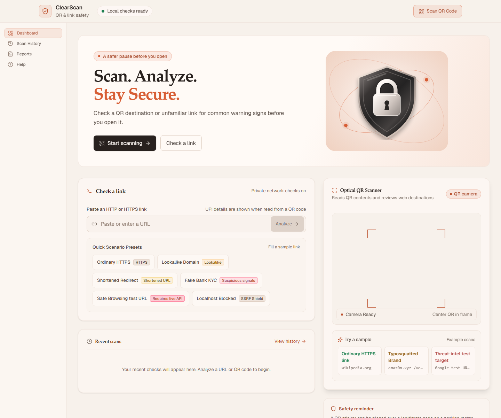
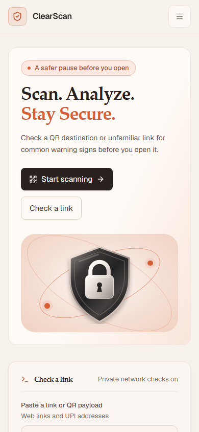

# ClearScan — Scan Before You Trust

ClearScan is a QR and URL review assistant. It reads QR payloads, analyzes HTTP/HTTPS addresses for suspicious patterns, and presents an explainable risk score. It does not open scanned destinations or make payments.

## Current capabilities

- Camera based QR reading and manual HTTP/HTTPS URL analysis.
- Backend heuristic checks for URL structure, suspicious domain terms and TLDs, brand lookalikes, and known shortener domains.
- A weighted 0–100 risk score and the five classifications below.
- Optional Google Safe Browsing v4 lookup from the Java backend. The UI distinguishes `NOT_CONFIGURED`, `CHECKED_NO_MATCH`, `MATCH_FOUND`, `UNAVAILABLE`, and `NOT_CHECKED`.
- Local heuristic fallback when the backend times out, cannot be reached, or returns an invalid response. The report identifies itself as local-only; it does not imply a Google check occurred.
- UPI QR payload reading (`upi://pay`): shows the VPA, payee name, amount, and currency when present. Recipient identity is unverified. ClearScan does not open a payment app or initiate a payment.
- Browser-local scan history with a clear-all action. Stored links are reduced to their origin; URL path, query, fragment, and credentials are not retained in history.
- Safety education content and a quiz.

Message scanning is not implemented as a real analyzer and is not presented as a working scan feature. There is no user authentication or application database.

## Screenshots

The desktop image is a browser capture of the running app. The mobile image is the approved visual direction reference.





## Risk score and demo scenarios

Risk is calculated from the checks returned by the backend; the frontend does not assign a preset score. The backend takes the highest contribution and adds 40% of each other failed check's contribution, rounds to an integer, and caps the result at 100. A `CRITICAL` check enforces a minimum of 75. No failed checks produce 0. A required parsing or input guard failure produces -1 and `UNABLE_TO_VERIFY`.

| Risk score | Classification | Meaning |
| --- | --- | --- |
| 0–24 | `LOW_RISK` | No warning patterns were found in the checks that ran; this is not proof of safety. |
| 25–49 | `MODERATE_RISK` | Some unusual characteristics were found. |
| 50–74 | `HIGH_RISK` | Multiple or stronger suspicious indicators were found. |
| 75–100 | `CRITICAL_RISK` | Critical threat intelligence or a critical risk condition was reported. |
| -1 | `UNABLE_TO_VERIFY` | The input was unsupported, invalid, private, or required analysis could not complete. |

The current deterministic URL presets have these backend heuristic results when threat intelligence is not configured:

| Scenario | URL | Backend score |
| --- | --- | --- |
| Ordinary HTTPS | `https://www.wikipedia.org` | 0 (`LOW_RISK`) |
| Google lookalike and login path | `https://g00gle.com/login` | 41 (`MODERATE_RISK`) |
| Shortener and suspicious path | `https://bit.ly/sbi-urgent-update` | 26 (`MODERATE_RISK`) |
| Bank lookalike, HTTP, suspicious TLD and path | `http://sbi-kyc-update.xyz/verify` | 56 (`HIGH_RISK`) |
| Private destination | `http://localhost:8080/secret` | -1 (`UNABLE_TO_VERIFY`) |

The `testsafebrowsing.appspot.com` sample is only a Google Safe Browsing test target. It is not hardcoded as malicious. A match is reported only if the configured Google service returns one; with no key or an unavailable service, the report states that threat intelligence was not checked.

## Architecture

- **Frontend:** React, TypeScript, Vite, Tailwind CSS, and `html5-qrcode`. The root `package.json` is the active app.
- **Backend:** Java 17, Spring Boot 3.2.5, Spring MVC, Jakarta validation, and Maven. Source is under `backend/`.
- **History:** browser `localStorage`, key `clearscan_history_v1`; no database is configured.
- **API:** `POST /api/scan`, JSON request `{ "url": "https://example.org" }`. The existing legacy `status` field is preserved; richer response fields include `riskScore`, `riskClassification`, `securityChecks`, `analysisSource`, and `threatIntelligenceStatus`.

Example response shape (values are illustrative; each scan is calculated from its input and live check outcomes):

```json
{
  "url": "https://www.wikipedia.org",
  "status": "UNABLE_TO_VERIFY",
  "message": "No threats were detected by the checks performed. This does not guarantee that the website is safe.",
  "normalizedHostname": "www.wikipedia.org",
  "riskScore": 0,
  "riskClassification": "LOW_RISK",
  "riskMessage": "No threats were detected by the checks performed. This does not guarantee that the website is safe.",
  "recommendedAction": "No immediate threats detected. Still verify the domain before entering personal information.",
  "timestamp": "2026-01-01T00:00:00Z",
  "analysisSource": "BACKEND",
  "threatIntelligenceAvailable": false,
  "threatIntelligenceStatus": "NOT_CONFIGURED",
  "securityChecks": [
    { "checkName": "URL Validation", "passed": true, "riskContribution": 0, "riskLevel": "LOW", "explanation": "URL uses HTTPS with a valid structure.", "evidence": "" },
    { "checkName": "Suspicious Domain Keywords", "passed": true, "riskContribution": 0, "riskLevel": "LOW", "explanation": "No suspicious keywords detected in the domain.", "evidence": "" },
    { "checkName": "Lookalike Domain Detection", "passed": true, "riskContribution": 0, "riskLevel": "LOW", "explanation": "No brand impersonation patterns were detected.", "evidence": "" },
    { "checkName": "URL Shortener Detection", "passed": true, "riskContribution": 0, "riskLevel": "LOW", "explanation": "This URL does not use a known URL-shortening service.", "evidence": "" },
    { "checkName": "URL Structure Analysis", "passed": true, "riskContribution": 0, "riskLevel": "LOW", "explanation": "No suspicious structural patterns detected in the URL.", "evidence": "" },
    { "checkName": "Threat Intelligence", "passed": false, "riskContribution": 0, "riskLevel": "INFO", "explanation": "Google Safe Browsing was not checked because it is not configured. Local URL heuristics still ran; this is not a safe-list check.", "evidence": "Service: Not configured" }
  ],
  "warnings": ["Google Safe Browsing was not checked because it is not configured. Local URL heuristics still ran; this is not a safe-list check."]
}
```

Backend scanning parses the submitted URL and sends the URL string as data to the optional Safe Browsing service. It does **not** fetch destination pages, resolve destination hostnames, follow redirects, or browse arbitrary sites. The SSRF guard rejects private and special-use IP literals and local hostnames; because the scanner does not connect to destination hosts, DNS rebinding cannot redirect a destination fetch. Shortener targets are not expanded.

## Setup and run

Requirements: Node.js compatible with the installed Vite version, npm, and Java 17. No API key is required for local heuristic analysis.

### Frontend

From the repository root:

```sh
npm install
npm run dev
```

The Vite server runs at `http://localhost:5173` by default. To point it at a different backend, set `VITE_API_BASE_URL`, for example `http://localhost:8081/api`.

### Backend

In another terminal:

```sh
cd backend
./mvnw spring-boot:run
```

On Windows PowerShell, from `backend`, run `\.\mvnw.cmd spring-boot:run`. The server listens on port `8081`.

To enable Google Safe Browsing, configure the API key on the backend only:

```sh
GOOGLE_SAFE_BROWSING_API_KEY=your_key
CLEARSCAN_THREAT_INTEL_ENABLED=true
```

On PowerShell:

```powershell
$env:GOOGLE_SAFE_BROWSING_API_KEY = "your_key"
$env:CLEARSCAN_THREAT_INTEL_ENABLED = "true"
```

`clearscan.threat-intel.timeout-ms` controls the backend timeout (bounded to 250–15000 ms; default 5000 ms). Never add the API key to a `VITE_` variable or frontend source. Without both the enable flag and a key, the API reports `NOT_CONFIGURED`.

## Privacy and data handling

- Scan history exists in the current browser's local storage. The app stores only each URL origin there and removes path, query, fragment, and credentials. Clear history from the History page to delete saved records.
- The URL submitted for analysis, including its query string, is sent from the browser to the configured ClearScan backend. If Google Safe Browsing is enabled, the backend sends the full submitted URL to Google for the lookup.
- A UPI QR payload is parsed in the browser and is not sent to the URL scan API or added to URL history.
- The Google API key remains on the backend. Do not paste secrets into URLs you scan.

## Tests and build

```sh
npm test
npm run build
```

```sh
cd backend
./mvnw test
```

## Limitations

- A low score is not a safe-site certification. Heuristics can miss new threats or flag legitimate unusual links.
- Google Safe Browsing requires a valid backend API key and may be unavailable or rate-limited.
- The backend does not follow redirects, expand short links, fetch web pages, or verify merchant/payee identity.
- UPI names and VPAs are values supplied by the QR payload, not verified identity claims.
- History is local to the browser. There is no sign-in, cross-device sync, database, or implemented message-scanning analyzer.
- The scanned URL is temporarily displayed in the report and sent to the backend. Avoid scanning links containing credentials or private tokens.
